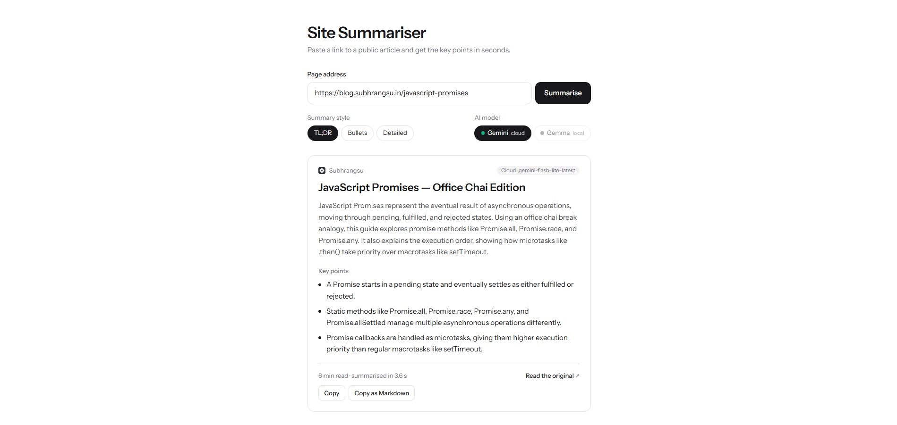

# Site Summariser

Paste a link to a public article and get a short summary back: a headline, a TL;DR and the key points.

It's an Angular 22 app with server-side rendering, and the small Express API that does the actual work lives in the same server. Summaries come from Gemini in the cloud, or from Gemma 4 running on your own machine through Ollama.

- Live demo: [site-summariser.vercel.app](https://site-summariser.vercel.app/)
- Demo video: [Google Drive](https://drive.google.com/file/d/1_NRgpSaHPQmRsOPR1tPZJIgAN_tNnMtg/view?usp=sharing)



## What it does

- Three summary styles: TL;DR, Bullets and Detailed.
- Two models: Gemini (cloud) or Gemma 4 (local). If a model isn't set up, its button is greyed out and tells you what's missing.
- The summary card shows the site name and favicon, headline, TL;DR, key points, reading time, which model answered, how long it took, and a link back to the article.
- Long pages are split into parts (up to 4 for Gemini, 3 for Gemma), summarised part by part and then combined.
- While it works you see a loading card with a timer. If something fails, you get a message that says what went wrong instead of a generic error.
- You can copy a summary as plain text or Markdown.
- Your last 10 summaries are kept in the browser, and you can click one to open it again.
- Dark mode follows your system. The form works from the keyboard, and results and errors are announced to screen readers.
- The server refuses to fetch internal addresses (SSRF protection).

## Running it locally

You need Node.js 22.12 or newer (I developed on Node 24) and npm.

```bash
npm install
cp .env.example .env      # then add your Gemini key
npm start                 # http://localhost:4200, the API runs inside the dev server
```

### Environment variables

| Variable                | What it's for                                                                                                                       |
| ----------------------- | ----------------------------------------------------------------------------------------------------------------------------------- |
| `GEMINI_API_KEY`        | Your Gemini key, free from [Google AI Studio](https://aistudio.google.com/apikey). Without it the Gemini option is greyed out.      |
| `GEMINI_MODEL`          | Main Gemini model. Defaults to `gemini-flash-lite-latest`, which is quick.                                                          |
| `GEMINI_FALLBACK_MODEL` | Model used for the retry when the main one fails or is overloaded. Defaults to `gemini-3.6-flash`; set it to `none` to turn it off. |
| `DEFAULT_PROVIDER`      | `gemini` or `ollama`: which model is selected when the page opens.                                                                  |
| `OLLAMA_SERVER`         | Where Ollama is running. Defaults to `http://127.0.0.1:11434`.                                                                      |
| `OLLAMA_MODEL`          | Local model name. Defaults to `gemma4:e2b`.                                                                                         |
| `OLLAMA_NUM_CTX`        | Context window for the local model in tokens. Defaults to `8192`.                                                                   |
| `PORT`                  | Port for the production server. Defaults to `4000`.                                                                                 |

### Using the local model (optional)

Install [Ollama](https://ollama.com), then pull the model:

```bash
ollama pull gemma4:e2b
```

The app checks whether Ollama is running and has the model. If not, the Gemma option is greyed out with the command you need to run. Everything else works fine with Gemini alone.

### Other scripts

```bash
npm run build          # production build (browser + server)
npm run start:prod     # serve the production build on http://localhost:4000
npm run test:server    # server tests (plain Vitest on Node)
npm test               # Angular tests
npm run test:all       # both test suites
npm run check:vercel   # after a build: check the serverless entry loads the way Vercel loads it
```

## How it works

```text
Browser (Angular 22: signals, httpResource, Signal Forms)
   │  GET  /api/providers                       which models can be used right now
   │  POST /api/summarise { url, mode, provider }
   ▼
Express API inside the Angular SSR server (src/server.ts)
   1. validate the request body (Zod)           → 400 INVALID_URL / INVALID_REQUEST
   2. check the chosen model is available       → 503 PROVIDER_UNAVAILABLE
   3. SSRF guard: scheme, port, DNS lookup      → 403 BLOCKED_URL
   4. fetch the page (10 s, HTML only, ≤ 2 MB)  → 502 FETCH_FAILED / 504 TIMEOUT
   5. extract the article (Readability + jsdom) → 422 NO_CONTENT
   6. long page? split it at sentence boundaries and take notes on each part
   7. Genkit → Gemini or Gemma, structured JSON → 503 AI_UNAVAILABLE / 422 NOT_SUMMARISABLE
   8. add reading time and metadata, return JSON
```

The app needs a backend for three reasons. Browsers won't let a page read another website (CORS), so the article can't be fetched from the browser. An API key in frontend code is public, so the Gemini key has to stay on the server. And a server that fetches URLs people type in must not be usable to reach internal addresses like the cloud metadata service at `169.254.169.254`, so every URL and every redirect is checked.

I kept the client and the API in one app because Angular SSR already runs an Express server. That means one install, one deploy and no CORS setup, and server code never ends up in the browser bundle. The API contract in `src/shared/api.types.ts` is a set of Zod schemas that both sides import. The server uses them to validate requests, the browser uses them to validate responses and saved history, and the TypeScript types are inferred from the same schemas.

## Tech stack

| Layer      | Choice                                                                                                            |
| ---------- | ----------------------------------------------------------------------------------------------------------------- |
| Frontend   | Angular 22: standalone components, signals, `httpResource`, Signal Forms, zoneless, OnPush, SSR with prerendering |
| Styling    | Tailwind CSS 4, with design tokens for light and dark mode                                                        |
| Backend    | Express 5 inside the Angular SSR server, TypeScript                                                               |
| Extraction | `@mozilla/readability` on `jsdom`                                                                                 |
| AI         | [Genkit](https://genkit.dev) with the Google GenAI plugin for Gemini, and a small custom Genkit model for Ollama  |
| Validation | Zod schemas shared by client and server (`zod/mini` in the browser); Genkit schemas for the model's output        |
| Tests      | Vitest: `ng test` for the Angular app, plain Vitest for the server                                                |
| Hosting    | Vercel: static files from the CDN, everything else in one serverless function (`api/index.mjs`, `vercel.json`)    |

## How AI is used in the app

All model calls go through Genkit. Both models use the same `ai.generate()` call, and the `provider` in the request only decides which model it goes to. Anything that differs between the two (timeouts, input size, temperature, whether parts run in parallel) lives in one table in `src/server/ai/providers.ts`.

The model has to answer with JSON in a fixed shape: `title`, `tldr` and `keyPoints`. Gemini enforces the schema itself. For Ollama I pass the schema as its `format` option, which constrains what the model can generate. Things a schema can't express, like "exactly 3 key points", are checked in code.

| Style    | TL;DR               | Key points                                  |
| -------- | ------------------- | ------------------------------------------- |
| TL;DR    | 2–3 sentences       | exactly 3                                   |
| Bullets  | 1 sentence          | 5–7                                         |
| Detailed | one short paragraph | up to 8, each a fact plus a line of context |

If the answer is missing, invalid or too short, or the model errors, is overloaded or times out, the server tries once more with a stricter instruction. For Gemini the retry goes to a fallback model, because Gemini sometimes answers 503 "high demand" for one model while another still works. The card shows which model actually answered. If the retry fails too, the API returns `AI_UNAVAILABLE` and the UI suggests trying the other model.

The prompt (`src/server/ai/summary.prompt.ts`) tells the model to use only facts from the page and not to invent names, numbers, dates or quotes. It also says to treat the page as data rather than instructions. The page text goes last, between `<page>` and `</page>`, and any of those tags inside the scraped text are removed first, so a page can't break out of the delimiters. Login pages, error pages and the like come back as `NOT_SUMMARISABLE`.

Long pages use map-reduce. The text is split at sentence boundaries into parts that fit the model's input (about 12,000 characters for Gemini, 8,000 for Gemma). Each part is turned into short notes, in parallel for Gemini and one at a time for the local model. Then the notes are summarised in the chosen style. If a part fails, it's skipped. When a page was summarised in parts, or some of it couldn't be covered, the card says so. The whole request runs against one deadline, which keeps Gemini inside the 60-second limit of the hosting platform.

Reading time is worked out on the server from the word count (about 200 words a minute). The model doesn't estimate it.

I wrote a small custom Genkit model for Ollama instead of using the `genkitx-ollama` plugin, because the plugin can't send Ollama's `think` and `format` options. With thinking left on, one summary took 70–90 seconds on my CPU. With `think: false` it takes 15–25 seconds, and `format` keeps the output valid JSON.

## API

### `POST /api/summarise`

```json
{ "url": "https://example.com/article", "mode": "tldr", "provider": "gemini" }
```

`mode` is `tldr`, `bullets` or `detailed` (default `tldr`). `provider` is optional: `gemini` or `ollama`. If you leave it out, the server uses `DEFAULT_PROVIDER`.

A successful response looks like this:

```json
{
  "source": { "url": "...", "siteName": "...", "title": "...", "favicon": "..." },
  "summary": { "title": "...", "tldr": "...", "keyPoints": ["..."], "readingTimeMin": 5 },
  "meta": {
    "provider": "gemini",
    "model": "gemini-flash-lite-latest",
    "truncated": false,
    "chunks": 1,
    "ms": 4174
  }
}
```

`chunks` is how many parts the page was summarised in. `truncated` is `true` when some of the page isn't covered.

Every error has the same shape, `{ "error": { "code": "...", "message": "..." } }`:

| HTTP | Code                              | When                                                              |
| ---- | --------------------------------- | ----------------------------------------------------------------- |
| 400  | `INVALID_URL` / `INVALID_REQUEST` | Not an http(s) address, or a bad request body                     |
| 403  | `BLOCKED_URL`                     | Localhost, a private or link-local address, or a non-default port |
| 422  | `NO_CONTENT`                      | Under ~200 words of readable text (often a JavaScript-only site)  |
| 422  | `NOT_SUMMARISABLE`                | The model found no article (login page, error page)               |
| 502  | `FETCH_FAILED`                    | The site refused, returned an error, or isn't an HTML page        |
| 503  | `AI_UNAVAILABLE`                  | Model error, rate limit or unusable answer after one retry        |
| 503  | `PROVIDER_UNAVAILABLE`            | The chosen model isn't set up (no key, or Ollama not running)     |
| 504  | `TIMEOUT`                         | The page took more than 10 s to load                              |

### Other endpoints

`GET /api/providers` lists the models and, for any that can't be used, why not. `GET /api/health` returns `{ "ok": true }`.

## Edge cases

| Case                                                                                                | What happens                                                                                                     |
| --------------------------------------------------------------------------------------------------- | ---------------------------------------------------------------------------------------------------------------- |
| No `https://` in the address                                                                        | Added automatically                                                                                              |
| Malformed address                                                                                   | Inline message, and the submit button is disabled                                                                |
| Localhost, private IPs, decimal or hex IPs, IPv6 loopback, public names that resolve to private IPs | Blocked by the SSRF guard                                                                                        |
| A redirect to an internal address                                                                   | Blocked: redirects are followed by hand (up to 5) and every hop is checked                                       |
| IPv6-only network (NAT64)                                                                           | Public sites still work, because the IPv4 address inside `64:ff9b::/96` is what gets checked                     |
| Site blocks bots                                                                                    | A 403 is retried once with a different User-Agent; after that, "This site blocks automated access"               |
| JavaScript-only page                                                                                | "This page has too little readable text"                                                                         |
| PDF, image or other file                                                                            | "Only web pages are supported for now"                                                                           |
| Very large page                                                                                     | Only the first 2 MB of HTML is read, long text is summarised in parts, and the card says if anything is left out |
| Slow site                                                                                           | Gives up after 10 s                                                                                              |
| Model busy, rate-limited, slow or returns bad JSON                                                  | One retry (on the fallback model for Gemini), then a message suggesting the other model                          |
| Model not set up                                                                                    | Option greyed out with the fix; the API answers `PROVIDER_UNAVAILABLE` straight away                             |
| New URL submitted while one is loading                                                              | The old request is cancelled in the browser, and the server stops working on it                                  |

## Project structure

```text
src/
├── server.ts                    Express: /api router → static files → Angular SSR
├── server/                      server-only code, never bundled into the browser
│   ├── api/                     routes: summarise, providers, router
│   ├── ai/                      Genkit setup, providers table, Ollama model, schema, prompt
│   ├── services/                scraper (fetch + Readability), summarise pipeline
│   ├── utils/                   SSRF guard, chunking, API errors
│   └── config.ts                environment variables
├── shared/api.types.ts          Zod schemas and types for the API, used by client and server
└── app/
    ├── core/                    API service (httpResource), error mapping, history store
    ├── features/summariser/     the page, URL form, summary card, loading skeleton, error state, history list
    └── shared/pipes/            readingTime, duration, relativeTime
api/index.mjs                    serverless function entry
vercel.json                      build and routing for the hosted demo
```
